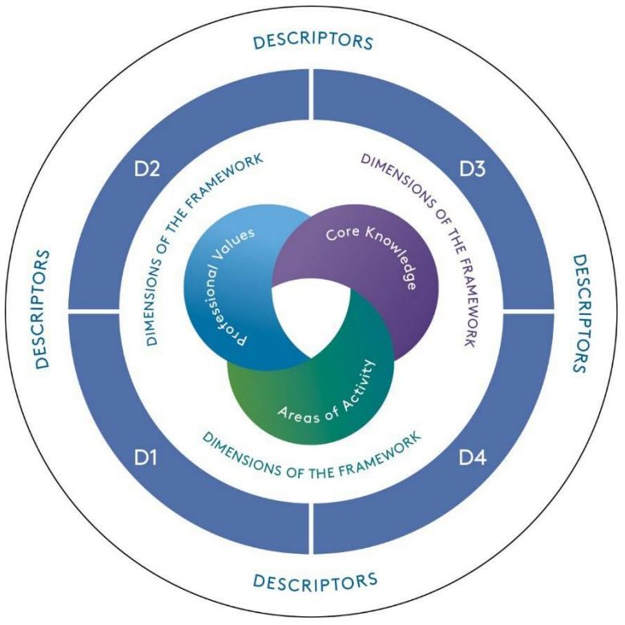

# Applying for Higher Education Academy Fellowship in The University of Bath

This page is dedicated to members of staff and GTAs in the University of Bath's Mathematics Department who are planning to apply for the Higher Education Academy Fellowship.  The resources on this page will *only* be accessible to those members of staff and GTAs of the University of Bath.  The HEA Champion and HEA GTA mentor for the Maths Department is [me](mailto:w.a.a.ali@bath.ac.uk).

Note that in what follows, the term "*Gateway Deadline*" refers to the time by which you should *inform* your HEA Champion about your intention to submit.  You do not have to have a draft ready, just the intention to submit by that round.

### Key Dates 2026-2027

| Review Round | Gateway Deadline (Noon) | Submission Deadline (Noon) |
|:------------:|:----------------------------:|:--------------------------:|
| Round 1      | Friday 11/09/2026            | Friday 16/10/2026          |
| Round 2      | Friday 08/01/2027            | Friday 12/02/2027          |
| Round 3      | Friday 09/04/2027            | Friday 14/05/2027          |

## Steps for Application

:::{.panel-tabset}

# Experiential Pathway

This pathways is for the members of staff who *are not* on probation.

0. Enrol (as a student) and complete [First Steps into Teaching](https://moodle.bath.ac.uk/enrol/index.php?id=58363).  This step may not be necessary for those with prior teaching experience.

1. Check the appropriate level of application by using the [Fellowship Category Tool](https://www.advance-he.ac.uk/form/fellowship-decision-tool-2023).

2.  On the [CLT website](https://teachinghub.bath.ac.uk/events/categories/pathways/), sign up for and attend **both** of the following sessions (this is a **mandatory step**):
     - *20 - Introduction to Fellowship (Associate Fellow, Fellow and Senior Fellow)*,
     - *21 - Reflective Writing Support (Associate Fellow, Fellow and Senior Fellow)*.

3. Make sure you have been enrolled on the [Experiential Pathway](https://moodle.bath.ac.uk/course/view.php?id=59370) Moodle page.  If you have not been enrolled, contact your department's [HEA Champion](mailto:w.a.a.ali@bath.ac.uk).

4. Inform your department's HEA Champion about your intention to submit before the *Gateway Deadline*.

5. Make sure you have been enrolled on the [Gateway to Fellowship Submission](https://moodle.bath.ac.uk/course/view.php?id=59371) on Moodle.

6. Work with your department's HEA Champion to draft a fellowship application.

7. Identify your advocates.  These should be members of staff who can verify the teaching practices stated in your application (possibly by having observed your teaching):
     + **AFHEA**:  1 advocate,
     + **FHEA**:   2 advocates,
     + **SFHEA**:  1 internal advocate and 1 external advocate.

8. Write and receive feedback on your application from your department's HEA Champion.

9. Act on the feedback, finalise the application and pass it to advocates to complete their statements.

10. Submit your application before the *Submission Deadline*.

# Early Career Pathway

This pathway is for members of staff who *are* on probation.  Bear in mind that the **Early Career Pathway** (formerly known as the **Probationer Pathway**) is run by the CLT.  All the communication about the probation, as well as the HEA application, will be communicated directly.  The following is not an ordered list, but a list of actions that need to be taken in order to progress through the FHEA trajectory as a probationer.

* Typical timeline:  This includes completing *all* required Pathways sessions, consolidate practice and gather evidence across two (or three) consecutive semesters:
   - Education focussed:  12 months
   - Education and research:  18-24 months

* Sign up for and attend *all* the required sessions as listed [here](https://teachinghub.bath.ac.uk/wp-content/uploads/2026/07/Early-Career-planner-LT-TR-FHEA-2026-27-2.pdf) from the [CLT Events page](https://teachinghub.bath.ac.uk/events/categories/pathways/).

* The Early Career Pathway will account for 80 workload hours.

* Make sure you have been enrolled on the [Early Career Pathway](https://moodle.bath.ac.uk/enrol/index.php?id=59363) Moodle page.  If you have not been enrolled, contact [acdev](mailto:acdev@bath.ac.uk).

* Make sure you have been enrolled on the [Gateway to Fellowship Submission](https://moodle.bath.ac.uk/course/view.php?id=59371) on Moodle.  

* Identify your advocates.  These should be members of staff who can verify the teaching practices stated in your application (possibly by having observed your teaching).  The FHEA application requires *1 advocate* and *1 senior observer* (senior observers are arrange by the Pathways Team).

# GTA Pathway

This pathway is for GTAs (Graduate Teaching Assistants), usually PhD students or research associates whose role is to deliver material instead of preparing it.  For the GTA pathway, the recommendation is to apply for **AFHEA**.  Applications for **FHEA** are suitable only in *very* exceptional circumstances, particularly when you have much more extensive teaching responsibilities, like preparation of material and assessment as well as delivering lectures to larger classes.

1. Enrol (as a student) and complete [First Steps into Teaching](https://moodle.bath.ac.uk/enrol/index.php?id=58363).

2. Complete the *GTA Pathway to Fellowship* course on [Moodle](https://moodle.bath.ac.uk/course/view.php?id=59695&section=16), you will then need to contact your Champion for further mentoring.

3. Sign up for and attend *21 - Reflective Writing Support (Associate Fellow, Fellow and Senior Fellow)* through the [CLT website](https://teachinghub.bath.ac.uk/events/categories/pathways/).

4. Make sure you have been enrolled on the [GTA Pathway](https://moodle.bath.ac.uk/course/view.php?id=59695&section=16) Moodle page.  If you have not been enrolled, contact your [HEA GTA mentor](mailto:w.a.a.ali@bath.ac.uk).

5. Inform your department's HEA Champion about your intention to submit before the *Gateway Deadline*.

6. Make sure you have been enrolled on the [Gateway to Fellowship Submission](https://moodle.bath.ac.uk/course/view.php?id=59371) on Moodle.

7. Work with your department's HEA Champion to draft a fellowship application.

8. Identify your advocate; this should be a member of staff who can verify the teaching practices stated in your application (possibly by having observed your teaching).

9. Write and receive feedback on your application from your department's HEA Champion.

10. Act on the feedback, finalise the application and pass it to advocates to complete their statements.

11. Submit your application before the *Submission Deadline*.

:::

### Dimensions of the Framework

[Professional Standards Framework](documents/PSF23.pdf)

{fig-align="center" width=50%}

::: {layout-ncol=3}

::: {.callout-note icon="false"}
## Areas of Activity
*In your context, demonstrate that you*:

**A1**  Design and plan learning activities and/or programmes

**A2**  Teach and/or support learning through appropriate approaches and environments

**A3**  Assess and give feedback for learning

**A4**  Support and guide learners

**A5**  Enhance practice through own continuing professional development
:::

::: {.callout-note icon="false"}
## Core Knowledge
*In your context, demonstrate that you*:

**K1**  How learners learn, generally and within specific subjects

**K2**  Approaches to teaching and/or supporting learning, appropriate for subjects and level of study

**K3**  Critical evaluation as a basis for effective practice

**K4**  Appropriate use of digital and/or other technologies, and resources for learning

**K5**  Requirements for quality assurance and enhancement, and their implications for practice

:::

::: {.callout-note icon="false"}
## Professional Value
*In your context, demonstrate that you*:

**V1**  Respect individual learners and diverse groups of learners

**V2**  Promote engagement in learning and equity of opportunity for all to reach their potential

**V3**  Use scholarship, or research, or professional learning, or other evidence-informed approaches as a basis for effective practice

**V4**  Respond to the wider context in which higher education operates, recognising
implications for practice

**V5**  Collaborate with others to enhance practice

:::

:::

### Summary of Requirements

| Fellowship Level         | AFHEA | FHEA | SFHEA |
|:------------------------:|:-----------:|:--:|:--:|
| **Background & Context** | 300 words   | 300 words  | 300 words |
| **Reflective Accounts**  | 1,400 words | 3,000 words | 3,000 words + 2 case studies (3,000 words) |
| **References**           | 200 words   | 500 words  | 500 words |
| **Areas of Activity**    | 2 A's       | A1--A5      | A1--A5     |
| **Core Knowledge**       | K1 K2 K3    | K1--K5      | K1--K5     |
| **Professional Values**  | V1 V3       | V1--V5      | V1--V5     |
| **Advocates**            | 1 advocate | *Early Career*: 1 internal, 1 senior *Experiential*: 2 advocates | 1 internal, 1 external |
| **Applicant Guidance**   | [PDF](documents/D1_Guidance.pdf) | [PDF](documents/D2_Guidance.pdf) | [PDF](documents/D3_Guidance.pdf) |
| **Guide to PSF Dimensions** | [PDF](documents/D1_Guide_PSF.pdf) | [PDF](documents/D2_Guide_PSF.pdf)| [PDF](documents/D3_Guide_PSF.pdf) |
| **Required Forms** | [Moodle](https://moodle.bath.ac.uk/mod/folder/view.php?id=1378053) | [Moodle](https://moodle.bath.ac.uk/mod/folder/view.php?id=1378054) | [Moodle](https://moodle.bath.ac.uk/mod/folder/view.php?id=1378055)
